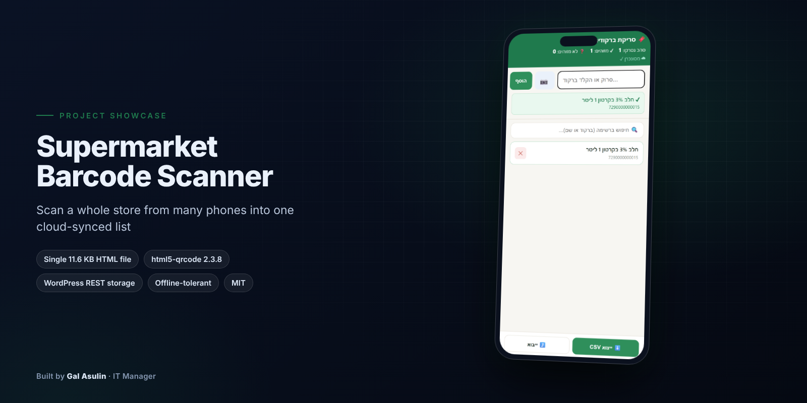
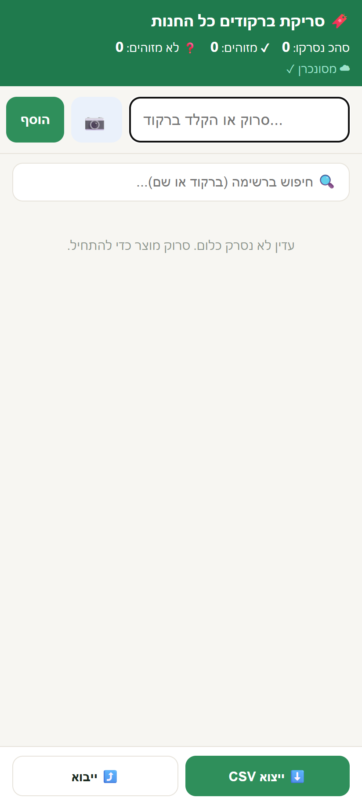
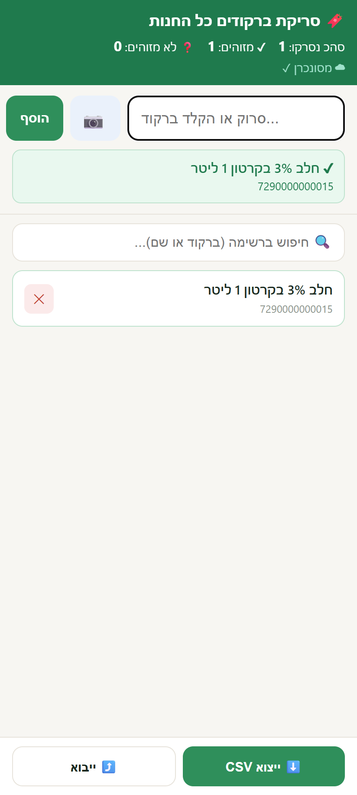
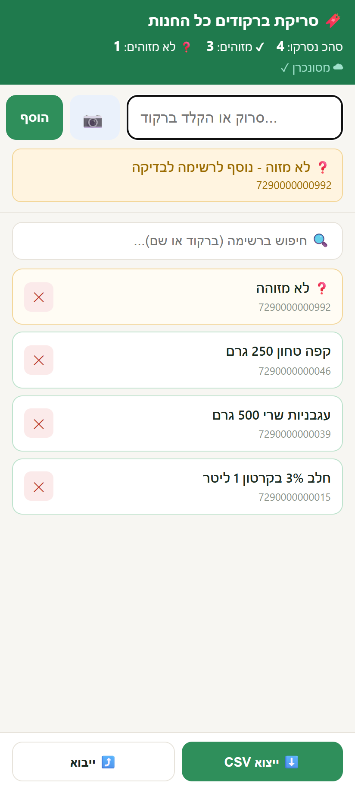
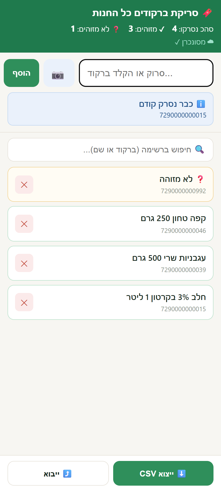
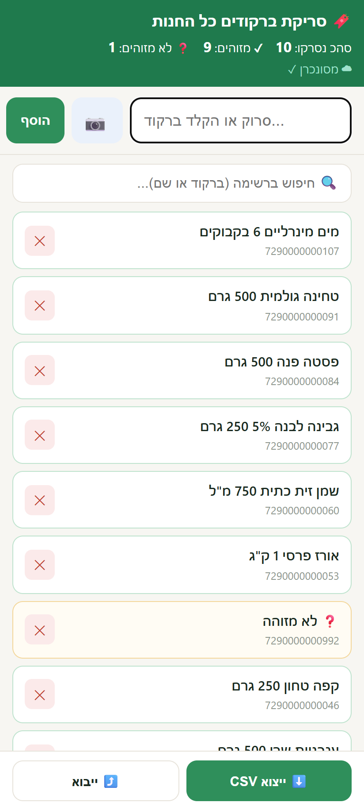
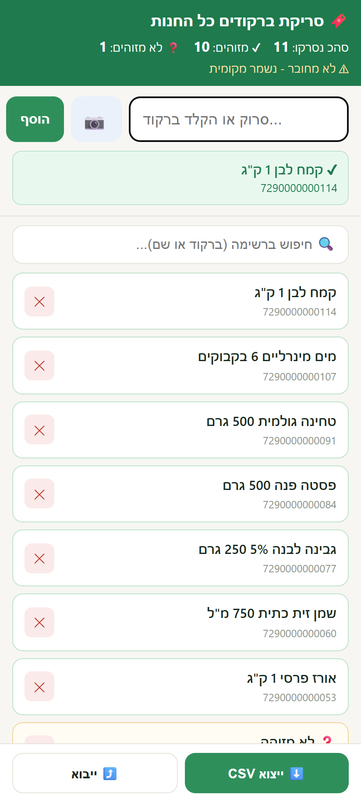
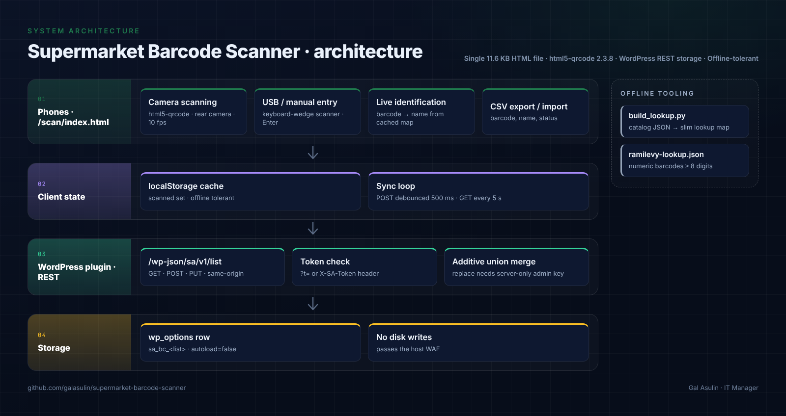
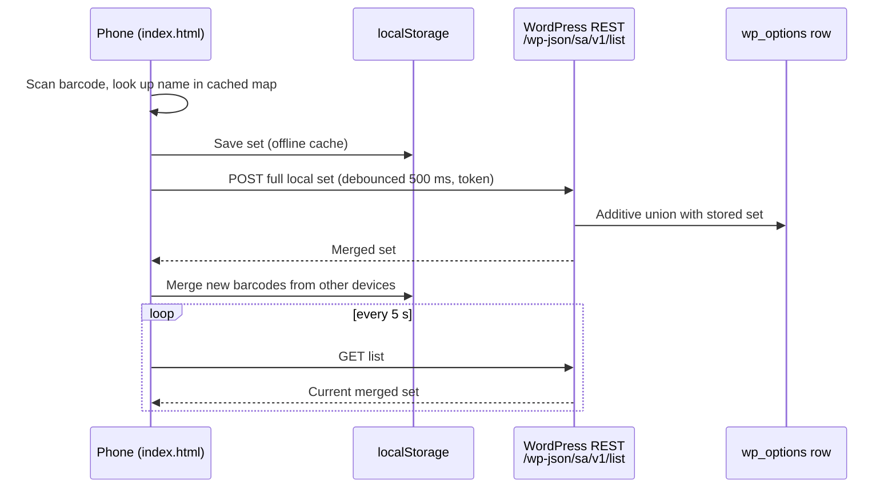

<p align="center"></p>

<h1 align="center">סורק ברקודים לסופרמרקט</h1>

<p align="center">סורק ברקודים בלי תלויות, מסונכרן לענן, לקטלוג של סופרמרקט שלם מכמה טלפונים במקביל.</p>

<p align="center"><a href="README.md">🇬🇧 English</a> · <a href="README.he.md">🇮🇱 עברית</a></p>

<div align="center">


**[מסכים](#-מסכים) · [ארכיטקטורה](#-ארכיטקטורה) · [פרמטרים טכניים](#-פרמטרים-טכניים) · [התקנה](#-התקנה)**

</div>

<div dir="rtl" align="right">

## 📋 במבט מהיר

| | |
|---|---|
| **סוג** | כלי ווב בקוד פתוח · סורק ברקודים לטלפון ותוסף אחסון ל-WordPress |
| **סטטוס** | נבנה בשביל [superasulin.co.il](https://www.superasulin.co.il) · התוסף בגרסה 1.0 |
| **טכנולוגיה** | ‏JavaScript נקי · ‏html5-qrcode · ‏WordPress REST API ‏(PHP) · ‏Python 3 |
| **התפקיד שלי** | תכנון ופיתוח, מקצה לקצה |
| **דמו חי** | אין (רץ על אתר ה-WordPress שלכם) |
| **שפות** | ממשק האפליקציה: עברית (RTL) · התיעוד: אנגלית / עברית |

---

## 📸 מסכים

צילומי המסך צולמו מה-`app/index.html` האמיתי, שרץ מקומית כשכל בקשה לשרת נענית על ידי שרת מדומה. שמות המוצרים והברקודים מומצאים, ושום דבר לא נשלח לאתר חי.

<table>
<tr>
<td align="center"><a href="docs/screenshots/demo.gif"></a><br><sub><b>דמו</b> · כל תהליך הסריקה</sub></td>
<td align="center"><a href="docs/screenshots/01-start.png"></a><br><sub><b>פתיחה</b> · רשימה ריקה, מסונכרן</sub></td>
</tr>
<tr>
<td align="center"><a href="docs/screenshots/02-identified.png"></a><br><sub><b>מזוהה</b> · שם המוצר מופיע מיד</sub></td>
<td align="center"><a href="docs/screenshots/03-unknown.png"></a><br><sub><b>לא מזוהה</b> · נשמר בכל זאת להתאמה בהמשך</sub></td>
</tr>
<tr>
<td align="center"><a href="docs/screenshots/04-duplicate.png"></a><br><sub><b>כבר נסרק</b> · זיהוי כפילות</sub></td>
<td align="center"><a href="docs/screenshots/05-shared-list.png"></a><br><sub><b>רשימה משותפת</b> · הסריקות של טלפון אחר מוזגו פנימה</sub></td>
</tr>
<tr>
<td align="center"><a href="docs/screenshots/06-offline.png"></a><br><sub><b>בלי רשת</b> · נשמר מקומית עד שהחיבור חוזר</sub></td>
<td></td>
</tr>
</table>

---

## 🧭 מה זה

באתר היו כ-700 מוצרים, אבל **לאף אחד מהם לא היה ברקוד**, ובחנות עצמה היו הרבה יותר פריטים מאשר באתר. לחפש כל מוצר ביד כדי לצרף לו ברקוד לא היה מעשי. המטרה: לסרוק את כל החנות, פריט אחרי פריט, מכמה טלפונים, למקום אחד, ואז למפות את מה שנסרק לנתוני מוצר אמיתיים ולמצוא מה חסר באתר.

הסורק מזהה כל ברקוד **בזמן אמת** מול מאגר זיהוי ושומר אותו ב**רשימה אחת משותפת בענן**, שכל המכשירים רואים תוך שניות. האחסון הוא תוסף WordPress קטן על האתר עצמו: בלי שירות צד שלישי, בלי חשבונות ובלי תשלום חודשי. את התוצאה מייצאים ל-CSV ומשלימים בה את נתוני המוצר המלאים (מותג, מחיר, רכיבים, אלרגנים, ערכים תזונתיים, תמונה).

---

## 🧩 יכולות מרכזיות

| תחום | יכולת |
|---|---|
| **סריקה** | מצלמת הטלפון (המצלמה האחורית, דרך `html5-qrcode`), סורק USB או Bluetooth, או הקלדה ידנית עם Enter |
| **זיהוי** | התאמה חיה של `ברקוד ← שם` תוך כדי סריקה. ברקוד לא מוכר נשמר בכל זאת ומסומן |
| **רשימה משותפת** | רשימה אחת לכל מספר של מכשירים, מסונכרנת דרך ה-WordPress של האתר עצמו |
| **מניעת כפילויות** | הודעת "כבר נסרק" אוטומטית, עם רטט בדפוס שונה |
| **עבודה בלי רשת** | הסריקות נשמרות במטמון מקומי ועולות אוטומטית כשהחיבור חוזר |
| **מונים וחיפוש** | מונים בכותרת: סך הכול / מזוהים / לא מזוהים. חיפוש ברשימה לפי ברקוד או שם |
| **ייצוא וייבוא** | ייצוא CSV של כל מה שנסרק (ברקוד, שם, סטטוס). ייבוא CSV ששולף ברקודים מקובץ ישן |
| **בטיחות** | כתיבה דורשת טוקן. כל כתיבה רגילה היא איחוד שרק מוסיף. החלפה הרסנית דורשת מפתח מנהל נפרד, שקיים רק בשרת |
| **עלות** | בלי שירות צד שלישי, בלי חשבונות, בלי תשלום חודשי |

---

## 🧱 ארכיטקטורה



צד הלקוח הוא קובץ `index.html` סטטי אחד, שמוגש מתיקיית `/scan/` באתר. הוא שומר את הברקודים שנסרקו ב-`localStorage` כמטמון לעבודה בלי רשת, וטוען פעם אחת מפה רזה של `ברקוד ← שם` (`ramilevy-lookup.json`, שנבנית בעזרת `scripts/build_lookup.py` מקטלוג שנאסף מהרשת) ושומר אותה מקומית. כל שינוי שולח את כל הרשימה של המכשיר לנתיב REST שתוסף WordPress קטן רושם. התוסף ממזג אותה לשורה אחת ב-`wp_options` ומחזיר את הרשימה הממוזגת, ופעם ב-5 שניות כל מכשיר מושך את הרשימה מהשרת וממזג אותה. מכיוון שהעמוד והנתיב יושבים באותו origin, אין צורך ב-CORS. ומכיוון ששום דבר לא נכתב לדיסק, חומת האש של האחסון (Wordfence/Imperva) לא מזהה אותו כ-web shell. הערות התכנון והסיפור של חומת האש נמצאים ב-[docs/architecture.md](docs/architecture.md).

### זרימה



---

## 📐 פרמטרים טכניים

| פרמטר | ערך |
|---|---|
| צד לקוח | קובץ סטטי אחד, `app/index.html`: ‏11.6 KB, ‏204 שורות, CSS ו-JavaScript נקי מוטמעים, `lang="he" dir="rtl"` |
| פענוח במצלמה | ‏`html5-qrcode` 2.3.8 (מ-jsDelivr) · מצלמה אחורית (`facingMode: environment`) · ‏10 פריימים בשנייה · אזור סריקה של 250×140 פיקסלים |
| קלט נוסף | סורק USB/Bluetooth שמתנהג כמקלדת, או הקלדה ידנית (Enter שולח) |
| סנכרון | דחיפה: `POST` של כל הרשימה המקומית, עם השהיה של 500 ms · משיכה: `GET` כל 5 שניות · בטעינה: קודם משיכה ואז דחיפה |
| נתיב REST | ‏`GET` / `POST` / `PUT` ‏`/wp-json/sa/v1/list` |
| הרשאת כתיבה | טוקן ב-`?t=` או בכותרת `X-SA-Token`. מצב החלפה דורש `?mode=replace&admin=<key>` |
| תשובות שגיאה | ‏`403` אין הרשאה (טוקן) · ‏`400` ‏JSON לא תקין · ‏`403` נדרש מפתח מנהל |
| אחסון בשרת | שורת `wp_options` אחת לכל רשימה, `sa_bc_<list>` (ברירת מחדל `scanned`, השם מוגבל ל-`a-z0-9`), ‏`autoload=false`. בלי כתיבה לדיסק |
| אחסון בצד הלקוח | ‏`localStorage`: רשימת הסריקות ומפת הזיהוי השמורה |
| סינון מפת הזיהוי | נשמרים רק ברקודים מספריים עם 8 ספרות לפחות. ‏JSON דחוס (כמה מאות KB) |
| הצגת הרשימה | מוצגות 300 השורות האחרונות. חיפוש לפי ברקוד ושם |
| ייצוא CSV | ‏UTF-8 עם BOM · עמודות `barcode,name,status` · ‏`scanned-barcodes.csv` |
| ייבוא CSV | שולף מהקובץ כל רצף של 6 ספרות ומעלה |
| רטט | ‏`navigator.vibrate`: ‏60 ms בסריקה חדשה, ודפוס קצר בכפילות |
| תוסף WordPress | ‏`sa-barcodes.php`, ‏60 שורות, גרסה 1.0 |
| בונה מפת הזיהוי | ‏`build_lookup.py`, ‏40 שורות, ‏Python 3 עם הספרייה הסטנדרטית בלבד |
| רישיון | ‏MIT |

---

## 🧠 החלטות הנדסיות

- **לרכוב על ה-REST API של WordPress במקום קובץ PHP עצמאי** ← הגרסה הראשונה (קובץ PHP שכותב JSON) נחסמה ב-`403` על ידי חומת האש של האחסון כ-web shell, בזמן שתעבורה ל-`/wp-json/` עברה ← המחיר: האחסון תלוי בכך ש-WordPress מותקן באותו אתר.
- **לשמור את הרשימה ב-`wp_options` ולא בדיסק** ← אין שום דבר שסורק הנוזקות יסמן, והכול באותו origin עם `/scan/`, כך שאין צורך ב-CORS ← המחיר: כל הרשימה יושבת בשורת option אחת.
- **איחוד שרק מוסיף בכל כתיבה** ← שני טלפונים שסורקים מעברים שונים אף פעם לא דורסים זה את זה, וכתיבה שנפלה מתקנת את עצמה בסריקה הבאה ← המחיר: מחיקת ברקוד דורשת את מסלול ההחלפה של המנהל. מחיקה מקומית חוזרת בסנכרון הבא.
- **השרת הוא מקור האמת, ו-`localStorage` הוא רק מטמון לעבודה בלי רשת** ← מכשיר חדש גם מקבל וגם תורם כבר בטעינה ← המחיר: מכשיר חדש צריך משיכה מוצלחת אחת כדי לראות את כל הרשימה.
- **משיכה כל 5 שניות במקום ערוץ דחיפה** ← HTTP רגיל שחומת האש כבר סומכת עליו, בלי תשתית נוספת ← המחיר: סריקות של מכשירים אחרים מופיעות באיחור של עד כ-5 שניות.
- **בלי backend של צד שלישי** ← ‏kvdb.io דרש מנוי בתשלום או אימות מייל לכתיבה, ל-jsonblob.com אין כותרות CORS, ואחסון חיצוני פירושו עוד חשבון. בעל האתר העדיף שהכול יישאר על השרת שלו.

---

## 🔧 התקנה

1. מעתיקים את `wordpress-plugin/sa-barcodes.php` אל `wp-content/plugins/` ומפעילים אותו (או אל `wp-content/mu-plugins/` כדי שייטען אוטומטית). מגדירים טוקן ומפתח מנהל משלכם בראש הקובץ.
2. בונים את מפת הזיהוי: `python scripts/build_lookup.py catalog.json app/ramilevy-lookup.json`.
3. מעלים את `app/index.html` ואת `ramilevy-lookup.json` לתיקיית `/scan/` באתר, ומגדירים את אותו טוקן ב-`index.html`.
4. פותחים את `https://your-site/scan/` בכל טלפון ומתחילים לסרוק.

## 📄 רישיון

‏MIT. ראו [LICENSE](LICENSE).

---

## 📁 מבנה הריפו

```
supermarket-barcode-scanner/
├── app/
│   ├── index.html                      Scanner front-end (single file)
│   └── ramilevy-lookup.sample.json     3-row sample of the barcode → name map
├── wordpress-plugin/
│   └── sa-barcodes.php                 REST storage plugin
├── scripts/
│   └── build_lookup.py                 Builds the slim lookup from a scraped catalog
├── docs/
│   ├── architecture.md                 Design notes and the WAF story
│   ├── screenshots/                    demo.gif + 6 phone screenshots
│   └── showcase/                       hero.png · architecture.png
├── screenshots/                        app-preview.svg · states.svg (UI previews)
├── LICENSE
└── .gitignore                          Keeps the real lookup and scraped catalogs out of git
```

---

## 🔐 פרטיות והיקף

- הקטלוג המלא ומפת הזיהוי המלאה **לא** נמצאים בריפו (נתונים של צד שלישי, וגם גודל). יש רק דוגמה של 3 שורות שמראה את הפורמט.
- הסודות בקבצים שבריפו הם ממלאי מקום (`CHANGE_ME_TOKEN`, ‏`CHANGE_ME_ADMIN_KEY`). מגדירים ערכים אמיתיים רק בהתקנה שלכם.
- צילומי המסך צולמו מהאפליקציה האמיתית שרצה מקומית מול שרת מדומה, עם מוצרים וברקודים מומצאים.

</div>

---

<div align="center"><b>Built by <a href="https://github.com/galasulin">Gal Asulin</a>, IT Manager</b></div>
