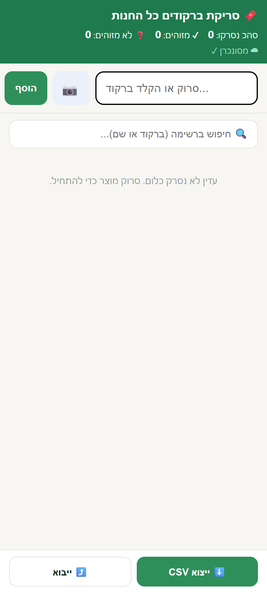
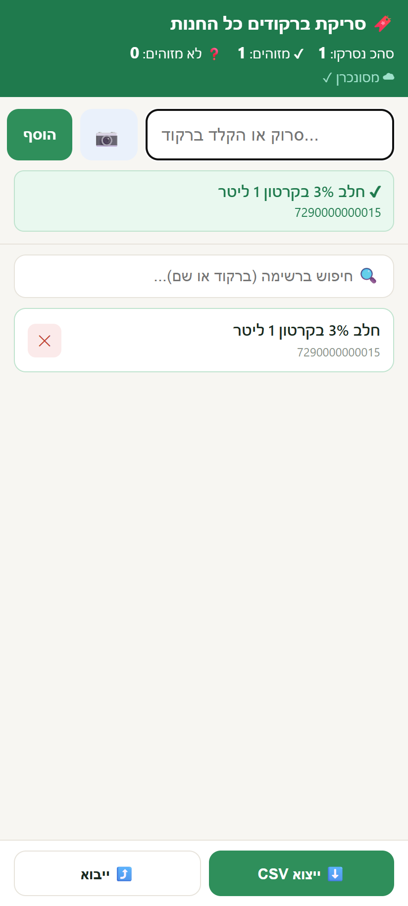
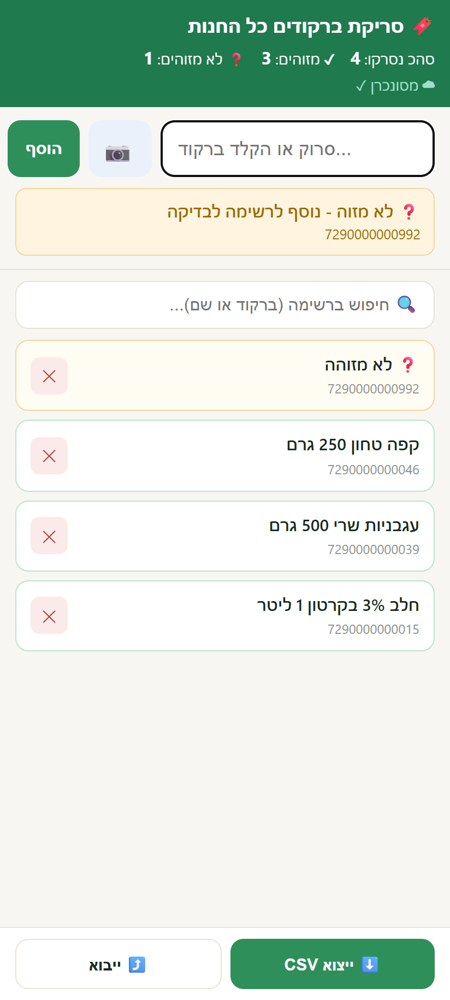
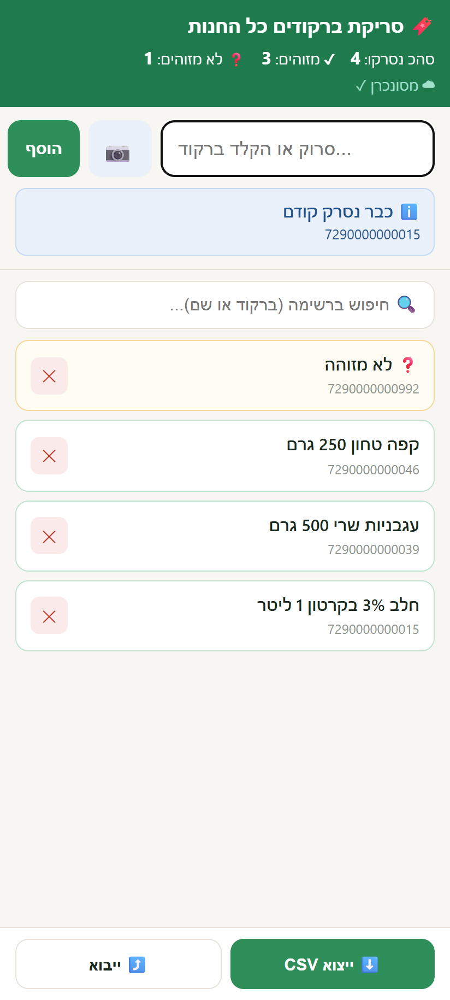
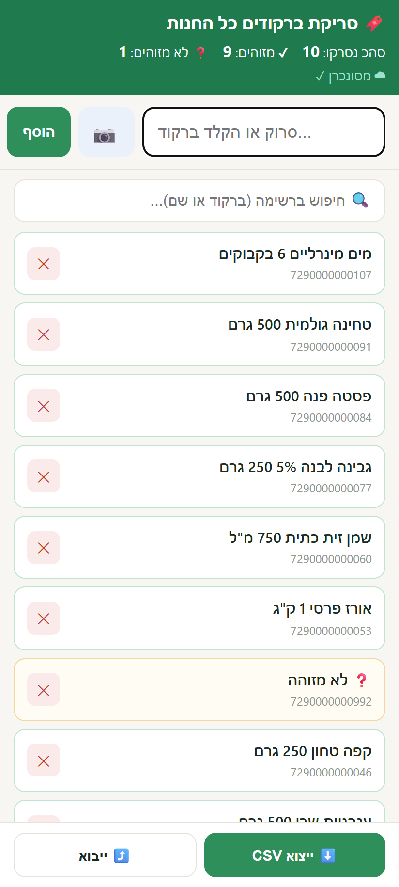
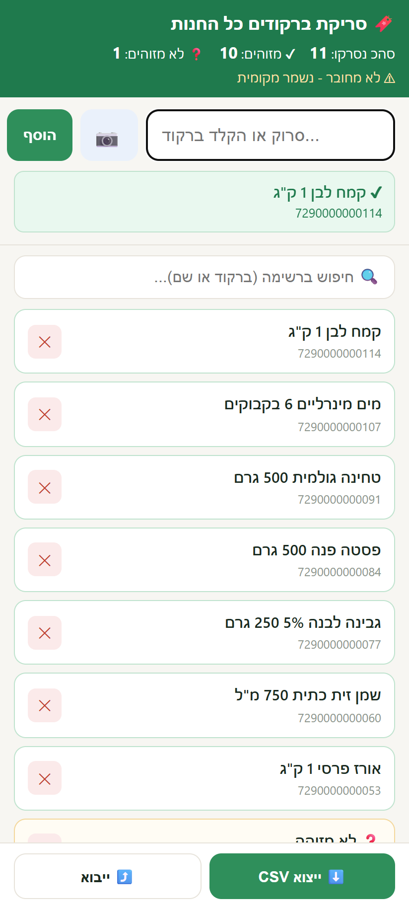

# 🛒 Supermarket Barcode Scanner

A tiny, dependency-free **cloud-synced barcode scanner** for cataloguing an
entire brick-and-mortar supermarket from any number of phones at once — built
for [superasulin.co.il](https://www.superasulin.co.il).

Walk the store, scan every product, and each barcode is **identified live**
against a product database and saved to **one shared cloud list** that every
device sees in real time. Export the result and enrich it with full product
data (brand, price, ingredients, allergens, nutrition, image).

<p align="center">
  
</p>

## Screenshots (local demo, invented products)

Captured from the real `app/index.html`, run locally with every backend request
answered by a stub. The product names and barcodes are invented; nothing was
sent to a live site.

<table>
  <tr>
    <td align="center"><br><sub>Start: empty list, synced</sub></td>
    <td align="center"><br><sub>Identified product</sub></td>
    <td align="center"><br><sub>Unknown barcode, still saved</sub></td>
  </tr>
  <tr>
    <td align="center"><br><sub>Already scanned</sub></td>
    <td align="center"><br><sub>Shared list (another phone's scans merged in)</sub></td>
    <td align="center"><br><sub>Offline: saved locally</sub></td>
  </tr>
</table>

---

## Why it exists

The site had ~700 products but **none of them had barcodes**, and the real
store held many more items than the site. Manually finding each product to
attach a barcode was hopeless. The goal:

> Scan the whole store, item by item, from several phones, into one place —
> then automatically map what was scanned to real product data and find what's
> missing from the site.

## Preview

<p align="center">
  
</p>

The three states you see while scanning — recognised, unrecognised, and duplicate:

<p align="center">
  
</p>

> UI previews rendered from the app's own markup. An unrecognised barcode is
> still saved — it just carries no product name until it's matched later.

## How it works

```
 phone A ─┐
 phone B ─┼──►  /wp-json/sa/v1/list  ──►  wp_options (WordPress DB)
 phone C ─┘        (REST endpoint)         one merged barcode set
     ▲                                             │
     └───────────── poll every 5s ◄────────────────┘

 each scan ──► look up barcode in ramilevy-lookup.json ──► show product name
```

- **Front-end** — a single static `index.html` (~12 KB). Camera scanning via
  `html5-qrcode`, or a USB/Bluetooth scanner / manual entry. Works offline and
  syncs when the connection returns.
- **Identification** — a slim `barcode → name` map (`ramilevy-lookup.json`,
  generated from a scraped catalog) is fetched once and cached in
  `localStorage`. Recognised barcodes show the product name instantly.
- **Storage** — a ~40-line WordPress plugin exposes a REST route that stores
  the merged set in a `wp_options` row. **No files are written on disk**, which
  matters: the host's WAF (Wordfence/Imperva) blocks stand-alone file-writing
  PHP as a "web shell", but trusts `/wp-json/` traffic.
- **Merge semantics** — every write is an additive union, so devices can scan
  in parallel and never overwrite each other. Destructive replace requires a
  separate admin key that lives only on the server.

## Features

- ✅ One shared list across unlimited devices, live-synced
- ✅ Live product identification while scanning
- ✅ Automatic de-duplication ("already scanned")
- ✅ Offline-tolerant (local cache, auto-upload on reconnect)
- ✅ CSV export of everything scanned
- ✅ No third-party service, no accounts, no monthly fee — runs entirely on the
  site's own WordPress

## Repository layout

| Path | What |
|------|------|
| `app/index.html` | the scanner front-end (single file) |
| `app/ramilevy-lookup.sample.json` | 3-row sample of the barcode→name map |
| `wordpress-plugin/sa-barcodes.php` | the REST storage plugin |
| `scripts/build_lookup.py` | builds the slim lookup from a scraped catalog |
| `docs/architecture.md` | design notes & the WAF story |

## Setup

1. Drop `wordpress-plugin/sa-barcodes.php` into `wp-content/plugins/` and
   activate it (or `wp-content/mu-plugins/` to auto-load). Set your own token
   and admin key at the top of the file.
2. Build the lookup: `python scripts/build_lookup.py catalog.json app/ramilevy-lookup.json`.
3. Upload `app/index.html` + `ramilevy-lookup.json` to a `/scan/` folder on the
   site. Set the same token in `index.html`.
4. Open `https://your-site/scan/` on any phone and start scanning.

## Notes

- The full product catalog / lookup is **not** committed (third-party data +
  size). Only a tiny sample is included to show the format.
- Secrets in the committed files are placeholders (`CHANGE_ME_TOKEN`,
  `CHANGE_ME_ADMIN_KEY`) — set real values in your own deployment.

## בעברית

סורק ברקודים קטן, בלי תלויות, לקטלוג של סופרמרקט שלם מכמה טלפונים במקביל.
כל ברקוד שנסרק מזוהה מיד מול מאגר מוצרים ונשמר ברשימה אחת משותפת בענן,
שכל המכשירים רואים בזמן אמת. האחסון הוא תוסף WordPress קטן שחושף נתיב REST
ושומר את הרשימה במסד הנתונים, בלי לכתוב קבצים לדיסק, כך שחומת האש של האחסון
לא חוסמת אותו. כל כתיבה היא איחוד, כך ששני טלפונים לא דורסים זה את זה, ואם
החיבור נופל הסריקות נשמרות מקומית ועולות כשהוא חוזר. בסוף מייצאים CSV.

צילומי המסך למעלה צולמו מהאפליקציה האמיתית שרצה מקומית, עם שרת מדומה ומוצרים
וברקודים מומצאים.

## License

MIT — see [LICENSE](LICENSE).

---

<div align="center">

**Built by [Gal Asulin](https://github.com/galasulin), IT Manager**

</div>
