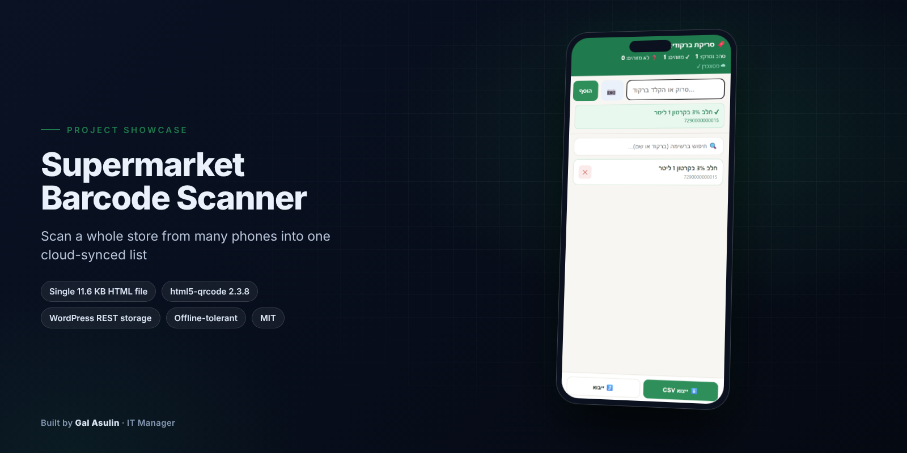
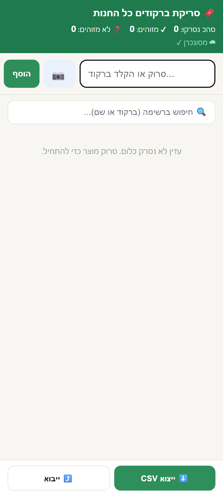
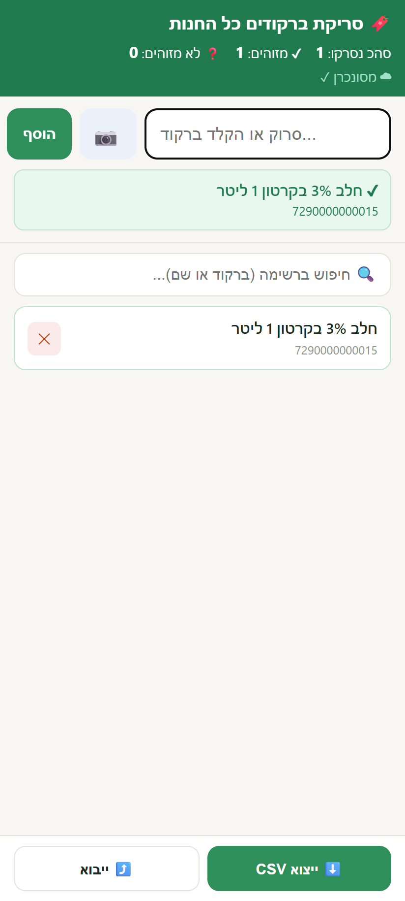
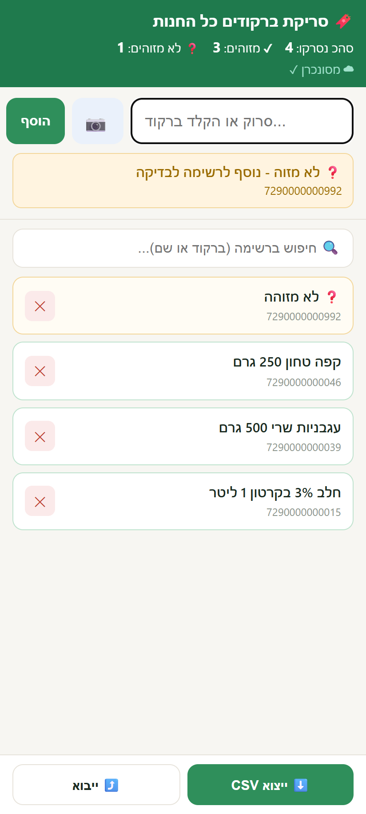
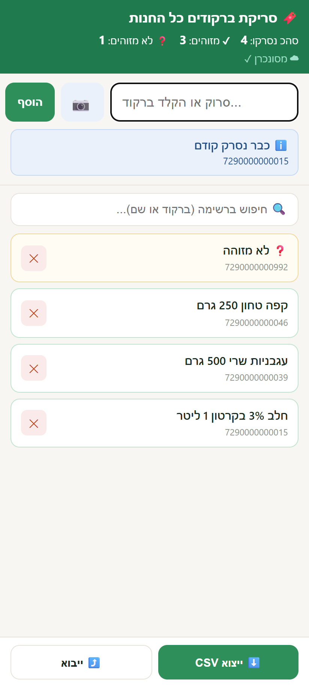
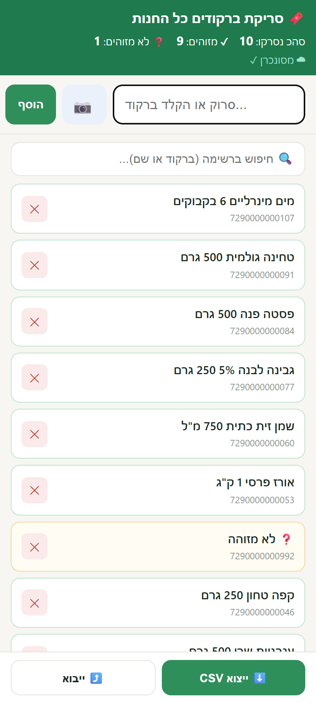
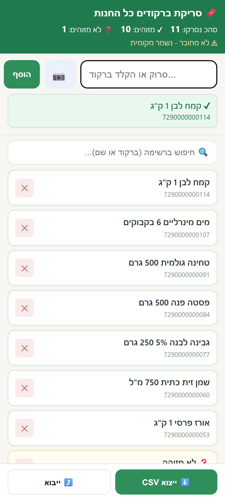
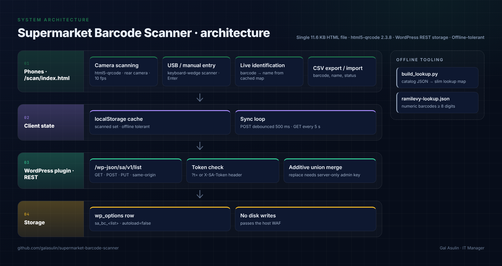
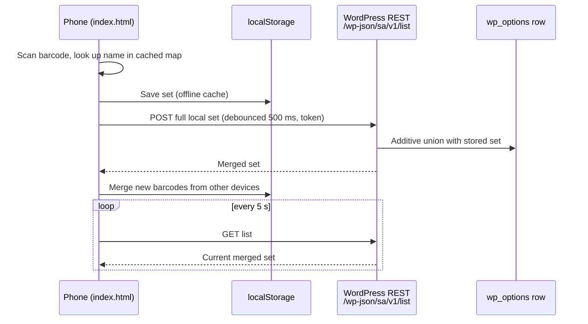

<p align="center"></p>

<h1 align="center">Supermarket Barcode Scanner</h1>

<p align="center">A dependency-free, cloud-synced barcode scanner for cataloguing a whole supermarket from many phones at once.</p>

<p align="center"><a href="README.md">🇬🇧 English</a> · <a href="README.he.md">🇮🇱 עברית</a></p>

<div align="center">


**[Screens](#-screens) · [Architecture](#-architecture) · [Tech](#-technical-parameters) · [Setup](#-setup)**

</div>

---

## 📋 At a glance

| | |
|---|---|
| **Type** | Open-source web tool · phone barcode scanner + WordPress storage plugin |
| **Status** | Built for [superasulin.co.il](https://www.superasulin.co.il) · plugin v1.0 |
| **Stack** | Vanilla JS · html5-qrcode · WordPress REST API (PHP) · Python 3 |
| **My role** | Design and development, end to end |
| **Live demo** | None (runs on your own WordPress site) |
| **Languages** | App UI: Hebrew (RTL) · Docs: English / Hebrew |

---

## 📸 Screens

Captured from the real `app/index.html`, run locally with every backend request answered by a stub. The product names and barcodes are invented; nothing was sent to a live site.

<table>
<tr>
<td align="center"><a href="docs/screenshots/demo.gif"></a><br><sub><b>Demo</b> · the full scanning flow</sub></td>
<td align="center"><a href="docs/screenshots/01-start.png"></a><br><sub><b>Start</b> · empty list, synced</sub></td>
</tr>
<tr>
<td align="center"><a href="docs/screenshots/02-identified.png"></a><br><sub><b>Identified</b> · product name shown instantly</sub></td>
<td align="center"><a href="docs/screenshots/03-unknown.png"></a><br><sub><b>Unknown</b> · still saved for later matching</sub></td>
</tr>
<tr>
<td align="center"><a href="docs/screenshots/04-duplicate.png"></a><br><sub><b>Already scanned</b> · duplicate detected</sub></td>
<td align="center"><a href="docs/screenshots/05-shared-list.png"></a><br><sub><b>Shared list</b> · another phone's scans merged in</sub></td>
</tr>
<tr>
<td align="center"><a href="docs/screenshots/06-offline.png"></a><br><sub><b>Offline</b> · saved locally until reconnect</sub></td>
<td></td>
</tr>
</table>

---

## 🧭 What it is

The site had ~700 products but **none of them had barcodes**, and the real store held many more items than the site. Finding each product by hand to attach a barcode was hopeless. The goal: scan the whole store, item by item, from several phones, into one place, then map what was scanned to real product data and find what is missing from the site.

The scanner identifies each barcode **live** against a product lookup and saves it to **one shared cloud list** that every device sees within seconds. Storage is a small WordPress plugin on the site itself: no third-party service, no accounts, no monthly fee. The result exports to CSV for enrichment with full product data (brand, price, ingredients, allergens, nutrition, image).

---

## 🧩 Key capabilities

| Area | Capability |
|---|---|
| **Scanning** | Phone camera (rear camera via `html5-qrcode`), USB/Bluetooth scanner, or manual entry with Enter |
| **Identification** | Live `barcode → name` lookup while scanning; unknown barcodes are still saved and flagged |
| **Shared list** | One list across unlimited devices, live-synced through the site's own WordPress |
| **De-duplication** | Automatic "already scanned" feedback, with a distinct vibration pattern |
| **Offline tolerance** | Scans are kept in a local cache and uploaded automatically when the connection returns |
| **Counters & search** | Header counters for total / identified / not identified; search the list by barcode or name |
| **Export / import** | CSV export of everything scanned (barcode, name, status); CSV import that recovers barcodes from an older file |
| **Safety** | Writes need a token; every normal write is an additive union; a destructive replace needs a separate admin key that lives only on the server |
| **Cost** | No third-party service, no accounts, no monthly fee |

---

## 🧱 Architecture



The front-end is a single static `index.html` served from a `/scan/` folder on the site. It keeps the scanned set in `localStorage` as an offline cache and loads a slim `barcode → name` map (`ramilevy-lookup.json`, built by `scripts/build_lookup.py` from a scraped catalog) once, caching it locally. Every change pushes the device's full set to a REST route registered by a small WordPress plugin, which merges it into one `wp_options` row and returns the merged set; every 5 seconds each device pulls and merges the server set. Because the page and the route share an origin, no CORS is needed, and because nothing is written to disk, the host's WAF (Wordfence/Imperva) does not flag it as a web shell. Design notes and the WAF story are in [docs/architecture.md](docs/architecture.md).

### Flow



---

## 📐 Technical parameters

| Parameter | Value |
|---|---|
| Front-end | One static file, `app/index.html`: 11.6 KB, 204 lines, inline CSS + vanilla JS, `lang="he" dir="rtl"` |
| Camera decoding | `html5-qrcode` 2.3.8 (jsDelivr) · rear camera (`facingMode: environment`) · 10 fps · 250×140 px scan box |
| Other input | USB/Bluetooth keyboard-wedge scanner or manual entry (Enter submits) |
| Sync | Push: `POST` of the full local set, debounced 500 ms · Pull: `GET` every 5 s · On load: pull, then push |
| REST route | `GET` / `POST` / `PUT` `/wp-json/sa/v1/list` |
| Write auth | Token in `?t=` or `X-SA-Token` header; replace mode requires `?mode=replace&admin=<key>` |
| Error responses | `403` forbidden (token) · `400` bad JSON · `403` admin key required |
| Server storage | One `wp_options` row per list, `sa_bc_<list>` (default `scanned`, name limited to `a-z0-9`), `autoload=false`; no disk writes |
| Client storage | `localStorage`: scanned set + cached lookup map |
| Lookup filter | Only numeric barcodes with ≥ 8 digits are kept; compact JSON output (a few hundred KB) |
| List rendering | Newest 300 rows rendered; search across barcode and name |
| CSV export | UTF-8 with BOM · columns `barcode,name,status` · `scanned-barcodes.csv` |
| CSV import | Extracts every run of ≥ 6 digits from the file |
| Haptics | `navigator.vibrate`: 60 ms on a new scan, a short pattern on a duplicate |
| WordPress plugin | `sa-barcodes.php`, 60 lines, v1.0 |
| Lookup builder | `build_lookup.py`, 40 lines, Python 3 standard library only |
| License | MIT |

---

## 🧠 Engineering decisions

- **Ride WordPress's REST API instead of a stand-alone PHP file** → the first version (a PHP file writing JSON) was blocked with `403` by the host's WAF as a web shell, while `/wp-json/` traffic passed → storage depends on WordPress being installed on the same site.
- **Store the set in `wp_options`, never on disk** → nothing for the malware scanner to flag, and same-origin with `/scan/`, so no CORS → the whole list lives in one option row.
- **Additive union on every write** → two phones scanning different aisles never overwrite each other, and a dropped write self-heals on the next scan → removing a barcode needs the admin replace path; a local delete comes back on the next sync.
- **Server is the source of truth, `localStorage` is only an offline cache** → a fresh device both receives and contributes on load → a new device needs one successful pull to see the full list.
- **Polling every 5 s instead of a push channel** → plain HTTP that the WAF already trusts, no extra infrastructure → other devices' scans appear with up to ~5 s delay.
- **No third-party backend** → kvdb.io needed a paid plan / email verification for writes, jsonblob.com sends no CORS headers, an external host meant another account; the owner preferred everything on their own server.

---

## 🔧 Setup

1. Drop `wordpress-plugin/sa-barcodes.php` into `wp-content/plugins/` and activate it (or `wp-content/mu-plugins/` to auto-load). Set your own token and admin key at the top of the file.
2. Build the lookup: `python scripts/build_lookup.py catalog.json app/ramilevy-lookup.json`.
3. Upload `app/index.html` + `ramilevy-lookup.json` to a `/scan/` folder on the site. Set the same token in `index.html`.
4. Open `https://your-site/scan/` on any phone and start scanning.

## 📄 License

MIT. See [LICENSE](LICENSE).

---

## 📁 Repository layout

```
supermarket-barcode-scanner/
├── app/
│   ├── index.html                      Scanner front-end (single file)
│   └── ramilevy-lookup.sample.json     3-row sample of the barcode → name map
├── wordpress-plugin/
│   └── sa-barcodes.php                 REST storage plugin
├── scripts/
│   └── build_lookup.py                 Builds the slim lookup from a scraped catalog
├── docs/
│   ├── architecture.md                 Design notes and the WAF story
│   ├── screenshots/                    demo.gif + 6 phone screenshots
│   └── showcase/                       hero.png · architecture.png
├── screenshots/                        app-preview.svg · states.svg (UI previews)
├── LICENSE
└── .gitignore                          Keeps the real lookup and scraped catalogs out of git
```

---

## 🔐 Privacy & scope

- The full product catalog / lookup is **not** committed (third-party data + size). Only a 3-row sample is included to show the format.
- Secrets in the committed files are placeholders (`CHANGE_ME_TOKEN`, `CHANGE_ME_ADMIN_KEY`); set real values in your own deployment.
- The screenshots were captured from the real app running locally against a stub backend, with invented products and barcodes.

---

<div align="center"><b>Built by <a href="https://github.com/galasulin">Gal Asulin</a>, IT Manager</b></div>
